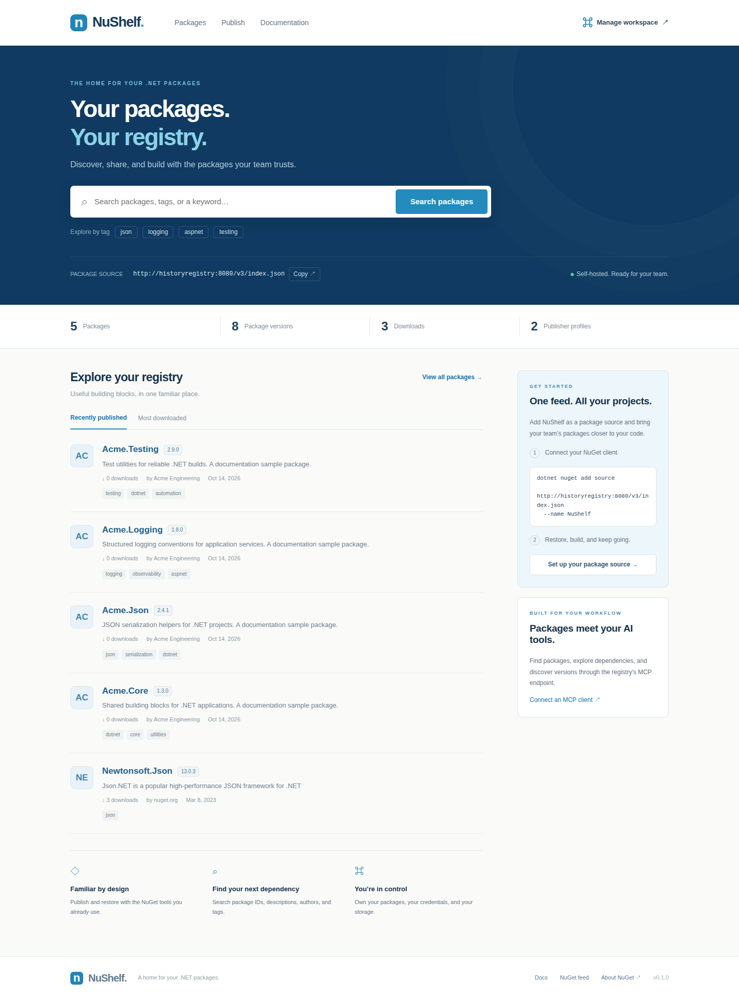
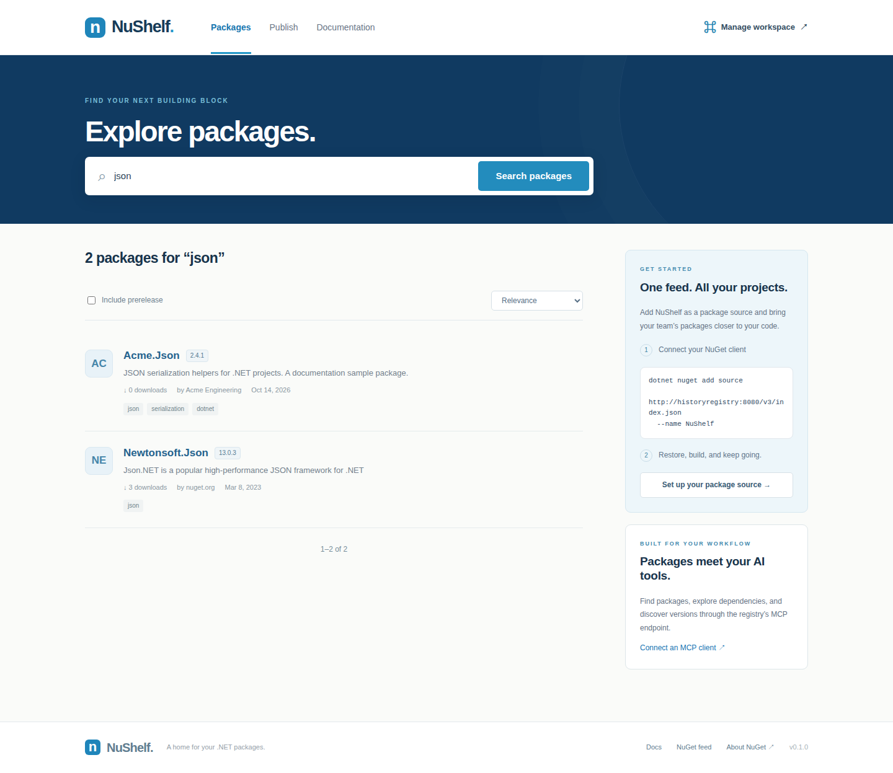
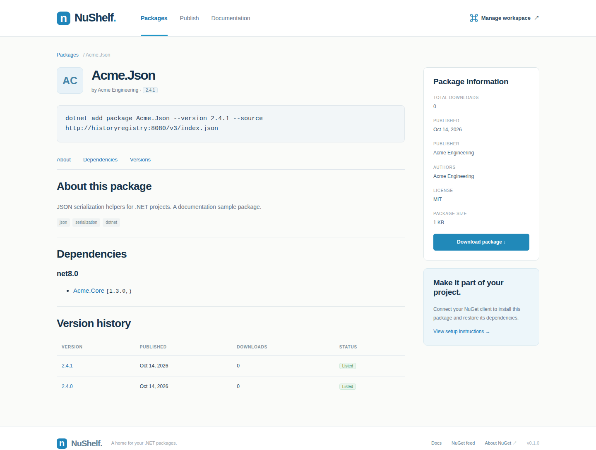
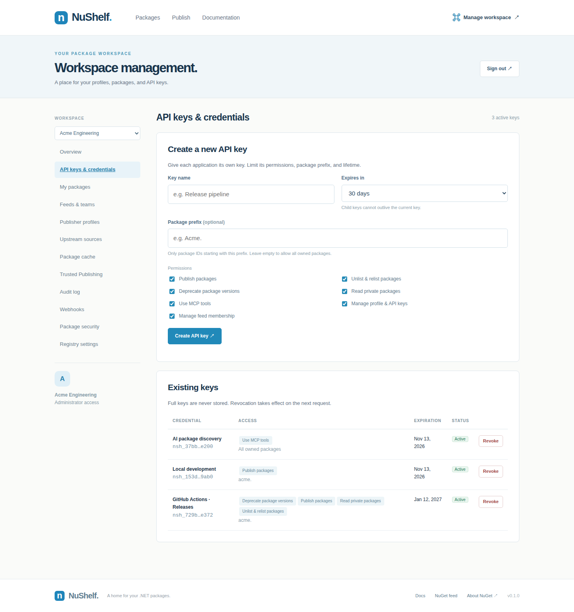
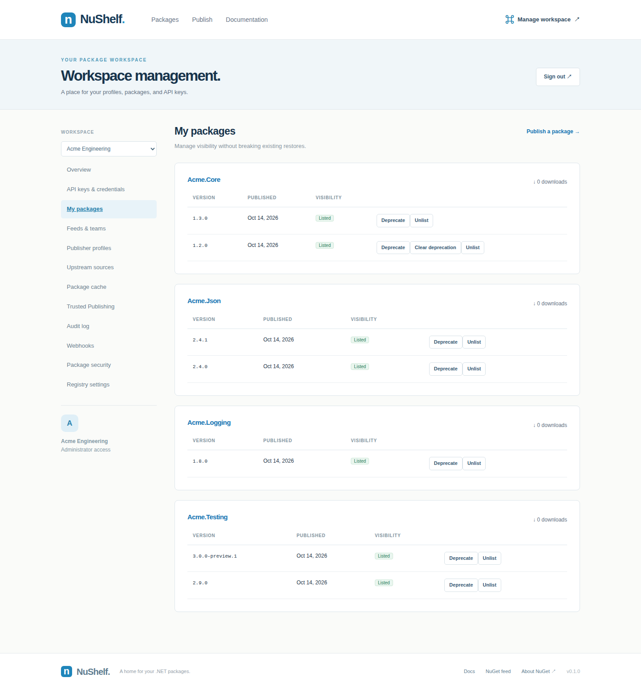
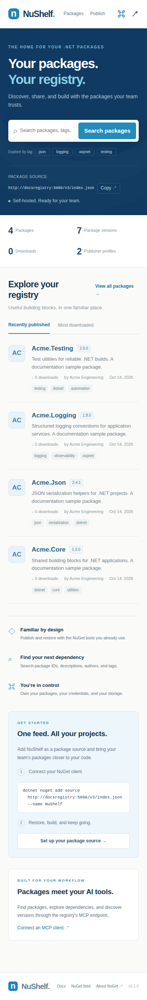
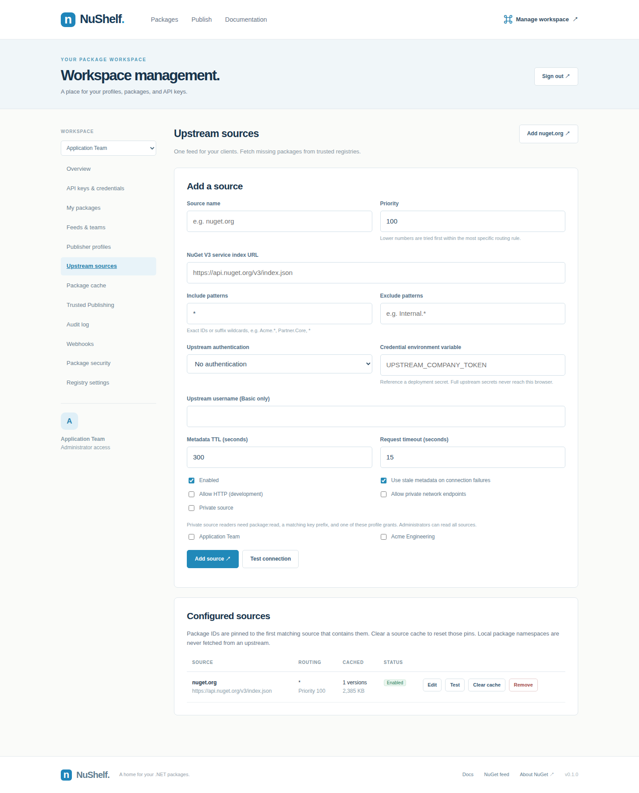
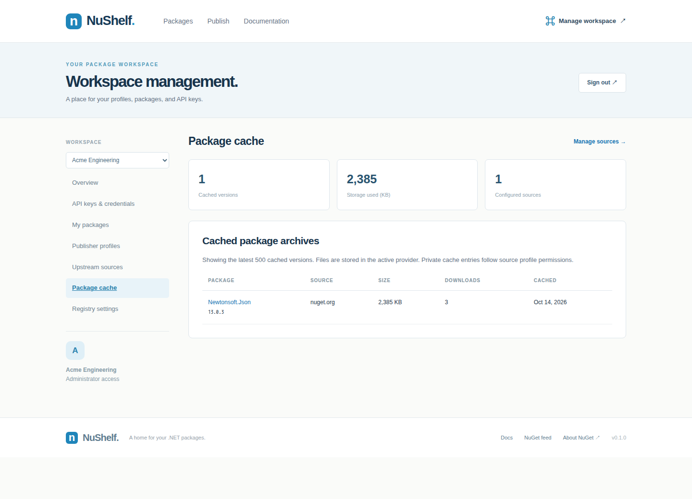
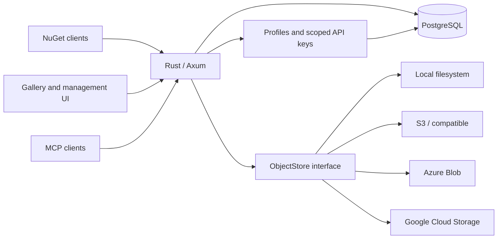

<div align="center">

# NuShelf.

**Your packages. Your registry.**

A self-hosted NuGet package registry built in Rust.<br>
PostgreSQL search, flexible storage, a familiar web gallery, and MCP tools for your AI workflow.


[Features](#features) · [Screenshots](#screenshots) · [Quick start](#quick-start) · [MCP](#mcp-integration) · [Documentation](#documentation)

</div>

NuShelf brings package discovery, publishing, and credential management into one workspace. Use the NuGet clients you already know, keep package files in your own storage, and let MCP clients inspect your registry through read-only tools.

Inspired by [BaGet](https://github.com/loic-sharma/BaGet)'s straightforward deployment model and the search-first experience of nuget.org.

<p align="center">
  
</p>

> **Project status:** working first release, v0.1.0. Docker integration, real .NET client, and browser flows have been exercised locally. See [current scope](#current-scope) for implemented features and limitations.

## Features

| Capability | What you can do |
| --- | --- |
| **NuGet V3 registry** | Publish `.nupkg` files, download packages and nuspec manifests, discover versions, fetch registration metadata, search, and autocomplete using standard NuGet endpoints. |
| **Package gallery** | Browse recent or popular packages; search IDs, tags, authors, and descriptions; filter prereleases; inspect dependencies and version history; upload a package in your browser. |
| **Private team feeds** | Isolate package namespaces, search, upstreams and storage by feed. Grant profiles reader, publisher or administrator membership; private reads require scoped credentials. |
| **Workspace management** | Create publisher profiles, edit profile names, manage credentials, and list or unlist owned package versions from a dedicated UI. |
| **Profile API keys** | Give each application its own key with explicit permissions, an optional package prefix, and an expiration date. Revoke keys independently. Full keys are shown once and stored as SHA-256 digests. |
| **Package ownership** | The first publishing profile owns a package ID. Other profiles cannot publish versions under that ID. Published versions are immutable; unlisting preserves existing restores. |
| **PostgreSQL search** | Weighted full-text search and indexed ID prefixes run first; trigram similarity provides a fallback. Search documents update in the same transaction as package metadata. |
| **Flexible storage** | Choose a local filesystem, AWS S3 or an S3-compatible service, Azure Blob Storage, or Google Cloud Storage through a shared storage interface. Package downloads are streamed. |
| **Upstream proxy & cache** | Fetch missing packages from multiple NuGet registries, route exact IDs/prefixes, pin origins, and cache archives in your storage. Manage sources and cache in the UI; private sources use profile grants and read scopes. |
| **NuGet Audit** | Mirror nuget.org vulnerability data locally, audit private-feed restores, and highlight affected package versions in the gallery. |
| **MCP tools** | Let an authenticated MCP client search packages, inspect metadata and dependencies, and list versions through stateless Streamable HTTP. |
| **Docker workflow** | Run the Rust service and PostgreSQL without installing either on the host. Separate test services cover filesystem and S3 storage, a real .NET client, and Chromium. |

Local package discovery and downloads are **public**. Private upstream caches require a profile grant and `package:read`; publishing and credential administration use profile or administrator keys. MCP requires `mcp:read` and respects private read permissions.

## Screenshots

These are real application captures from the isolated Docker environment. The `Acme.*` packages and publisher profile are illustrative documentation fixtures. Screenshots show credential hints, never full API keys.

<table>
  <tr>
    <td width="50%" valign="top">
      <strong>Search and discovery</strong><br>
      Relevance sorting, prerelease filtering, and package metadata.<br><br>
      <a href="docs/images/search.png"></a>
    </td>
    <td width="50%" valign="top">
      <strong>Package details</strong><br>
      Installation commands, dependency groups, and version history.<br><br>
      <a href="docs/images/package.png"></a>
    </td>
  </tr>
</table>

### Credentials and profiles

Create separate credentials for CI publishing, local development, and AI package discovery. Each key has its own scopes, package prefix, lifetime, and revocation status.



<details>
<summary><strong>View package management and mobile screenshots</strong></summary>

**Owned packages:** manage visibility for individual versions while keeping previously published content available for restore.



**Responsive gallery:** search and package browsing adapt to a narrow screen.

<p align="center">
  
</p>

</details>

## Quick start

**Requirements:** Docker with Compose support and Linux containers enabled. No host Rust or PostgreSQL installation is required.

### 1. Configure the deployment

For a fresh checkout, copy the example environment file. Preserve an existing `.env` if you already have one.

```bash
cp .env.example .env
```

On PowerShell, use `Copy-Item .env.example .env`.

Set two independent random secrets in `.env`:

```dotenv
ADMIN_API_KEY=<random-secret-at-least-32-characters>
POSTGRES_PASSWORD=<independent-random-URL-safe-password>
PUBLIC_URL=http://localhost:5000
STORAGE_PROVIDER=local
```

A 32-byte random value encoded as hex works for either secret. `.env` is excluded from Git.

### 2. Start NuShelf

```bash
docker compose up --build -d
```

| Endpoint | Address |
| --- | --- |
| Package gallery | [http://localhost:5000](http://localhost:5000) |
| Workspace management | [http://localhost:5000/manage](http://localhost:5000/manage) |
| NuGet package source | [http://localhost:5000/v3/index.json](http://localhost:5000/v3/index.json) |
| MCP endpoint | `http://localhost:5000/mcp` |

Migrations run automatically on startup. PostgreSQL and local package files use separate persistent Docker volumes. Set `PUBLIC_URL` to the externally reachable origin when deploying behind a proxy.

### 3. Create a publisher profile

1. Open **Manage workspace** and sign in with `ADMIN_API_KEY`.
2. Create a profile under **Publisher profiles**.
3. Open **API keys & credentials** and select the required scopes, prefix, and expiration.
4. Save the generated key; its full value is shown only once.

Use the **profile key** to publish packages. The administrator key manages profiles and credentials and cannot be used as a package push key.

## Publish and restore

Set `PROFILE_API_KEY` in your shell or CI secrets to a key with `package:push` permission, then use your existing .NET workflow:

```bash
# Connect your client.
dotnet nuget add source http://localhost:5000/v3/index.json --name NuShelf

# Build and publish a package.
dotnet pack --configuration Release
dotnet nuget push ./bin/Release/Your.Package.1.0.0.nupkg \
  --source http://localhost:5000/v3/index.json \
  --api-key "$PROFILE_API_KEY"

# Install from the registry.
dotnet add package Your.Package --version 1.0.0 \
  --source http://localhost:5000/v3/index.json
dotnet restore
```

You can also upload a `.nupkg` through the **Publish** page. Unlist or relist versions through **My packages**. Unlisted versions disappear from discovery but remain downloadable, so existing projects can still restore.

Recent NuGet clients may require explicit permission for a local HTTP source. The [deployment guide](docs/deployment.md#nuget-client-configuration) includes a `NuGet.Config` example; use an HTTPS origin for a hosted installation.

## Profiles and permissions

| Scope | Allowed operation |
| --- | --- |
| `package:push` | Publish packages under the key's permitted prefix. |
| `package:unlist` | Unlist or relist owned package versions under the permitted prefix. |
| `package:read` | Read a granted private upstream source within the key's package prefix. |
| `mcp:read` | Call read-only MCP tools against the public registry. |
| `keys:manage` | Manage the profile name and its API keys. |

A prefix such as `Acme.` restricts **package writes**, while profile ownership still protects existing package IDs. A `keys:manage` key can issue child keys, but cannot grant additional scopes, broaden its prefix, or extend its own lifetime. Keys remain independent: revoking an issuer does not automatically revoke its children.

The browser keeps the login key in tab memory rather than persistent browser storage. Reloading or signing out clears that login. Storage service credentials are configured through deployment secrets and are not returned by the management API.

## Storage providers

| Provider | Configuration | Verification |
| --- | --- | --- |
| **Local filesystem** | `STORAGE_PROVIDER=local` | Docker integration tested. |
| **AWS S3 / S3-compatible** | `STORAGE_PROVIDER=s3` | S3 behavior tested against MinIO in Docker; actual cloud endpoints need environment-specific validation. |
| **Azure Blob Storage** | `STORAGE_PROVIDER=azure` | Adapter compiled; not tested against a live Azure account. |
| **Google Cloud Storage** | `STORAGE_PROVIDER=gcs` | Adapter compiled; not tested against a live GCS account. |

For a local S3 environment, configure the MinIO values in `.env`, including a separate `AWS_SECRET_ACCESS_KEY`, then run:

```bash
docker compose --profile s3 up --build -d
```

The development MinIO fixture is built from pinned upstream source releases, and `minio-init` creates its bucket. Switching providers does not move existing package files automatically. See [storage configuration](docs/deployment.md#storage-configuration) for AWS, MinIO, Azure, GCS, and migration considerations.

## Upstream sources and package cache

Use NuShelf as a single source for local packages and upstream registries such as nuget.org. An uncached package is resolved from the most specific matching source rule, verified, and stored in your active provider. Subsequent downloads use the local cache; cached archives remain available during temporary origin outages.

In **Manage workspace → Upstream sources**, add the NuGet V3 index URL, priority, include/exclude rules, authentication secret reference, and metadata TTL. Use **Package cache** to inspect downloaded versions and clear a source cache. Sources are configured explicitly; the **Add nuget.org** preset supplies its public URL.

| Package rule | Example source |
| --- | --- |
| `Acme.*` | Company registry |
| `Partner.*` | Partner registry |
| `*` with internal namespace exclusions | nuget.org |

Local namespaces never fall back. Each resolved upstream package ID is pinned to one source, avoiding silent origin changes. Private sources require explicit profile read grants; upstream credentials stay in deployment environment variables. Search includes downloaded cache entries, with an exact-ID upstream lookup for uncached packages.

See the [upstream guide](docs/upstreams.md) for routing, credentials, offline behavior, cache headers, limits, and tests.



<details>
<summary><strong>View the package cache screen</strong></summary>



</details>

## MCP integration

NuShelf exposes three authenticated, read-only tools:

| Tool | Purpose |
| --- | --- |
| `search_packages` | Search listed packages by ID, tags, authors, or description, with optional prereleases and a result limit. |
| `get_package` | Inspect package metadata, dependencies, ownership, and published versions. |
| `list_versions` | List versions in NuGet precedence order, including unlisted versions. |

Create a profile key with `mcp:read`, then configure a client that supports remote HTTP MCP connections. Client configuration formats vary; this illustrates the endpoint and authorization header:

```json
{
  "mcpServers": {
    "nushelf": {
      "url": "http://localhost:5000/mcp",
      "headers": {
        "Authorization": "Bearer <PROFILE_API_KEY>"
      }
    }
  }
}
```

The transport is **stateless Streamable HTTP**, using MCP protocol `2025-06-18`. It returns JSON responses and accepts notifications; it does not expose mutation tools or a standalone SSE stream. Header and transport details are in the [MCP guide](docs/deployment.md#mcp-connection).

## Search performance

Search keeps at most four current documents per package ID for stable/prerelease and SemVer2 visibility. PostgreSQL GIN full-text indexes and ID prefix indexes serve primary matching; trigram search runs when primary matching finds no results. Metadata and search documents commit together.

Local Docker measurements with **50,000 synthetic packages** and **200,000 search documents**:

| Query | Matching packages | Median | p95 |
| --- | ---: | ---: | ---: |
| Exact package ID | 1 | 4.93 ms | 5.26 ms |
| Package ID prefix | 100 | 6.06 ms | 6.42 ms |
| Full text | 5,000 | 55.80 ms | 61.41 ms |
| Browse by recent publication | 50,000 | 10.48 ms | 11.84 ms |

Measurements include database count, pagination, and version lists using a development build, one caller, and warm caches. They exclude external HTTP latency and are not a production SLA. See the [benchmark method and query plan](docs/performance.md) to reproduce the run.

A separate **HTTP performance regression suite** tests 11 scenarios with 1, 8, and 32 concurrent clients against 50,000 packages. It checks every response for correctness, measures p50/p95/p99 and throughput, enforces configurable latency/throughput budgets with zero allowed errors, and checks the full-text query plan. Results are saved as JSON and Markdown; CI runs a smaller 10,000-package profile and uploads its reports.

```bash
docker compose -f compose.test.yml --profile performance run --rm --build performance
```

This suite uses a release build and includes HTTP routing, PostgreSQL work, response transfer, JSON decoding, and result validation. Its budgets are regression guardrails for the synthetic workload, not a deployment SLA. [Configuration and methodology](docs/performance.md#http-performance-regression-suite).

## Architecture



The runtime embeds the gallery assets into a Rust binary and runs as a non-root Docker user. PostgreSQL stores profiles, hashed credentials, ownership, version metadata, nuspec manifests, and search documents. The selected storage provider holds package archives. See the [architecture guide](docs/architecture.md) for transaction boundaries, concurrency, and backup considerations.

## Testing

All application verification runs inside Docker:

```bash
# Unit and PostgreSQL/filesystem/S3 integration tests.
docker compose -f compose.test.yml build test
docker compose -f compose.test.yml run --rm test

# Real .NET pack → push → install → restore → build → unlist → restore.
docker compose -f compose.test.yml --profile e2e up --build \
  --abort-on-container-exit --exit-code-from e2e e2e

# Browser publishing, profiles, credential management, and responsive layout.
# Run after the .NET test, which produces its package fixture.
docker compose -f compose.test.yml --profile ui run --rm --build ui

# Stop the isolated test stack.
docker compose -f compose.test.yml --profile e2e --profile ui down
```

Tests exercise NuGet version ordering, malformed ZIP/XML handling, ownership, key scopes and revocation, concurrent publication, search, autocomplete, listing changes, downloads, and MCP. The [CI workflow](.github/workflows/ci.yml) defines Docker formatting, Clippy, integration, .NET, and browser checks.

## Current scope

**Implemented:** NuGet V3 resources, V2-shaped push/delete endpoints, local package ownership, scoped keys, gallery and management UI, PostgreSQL search, pluggable storage, multiple upstreams with read-through cache and private grants, and read-only MCP.

**Not implemented yet:** legacy OData V2 feeds, symbol serving / `.snupkg`, proactive/full upstream mirroring, federated upstream keyword search, NuGet catalog feeds, package signature validation, automatic cache eviction, embedded README/icon rendering, password/OIDC login, email flows, public self-registration, and private reads in the root registry (named feeds support private local packages).

An interrupted upload can leave an unreferenced blob after storage succeeds but before the database commits; automatic orphan cleanup is not implemented. Readiness checks PostgreSQL rather than remote storage write permissions. The deployment guide covers these operational boundaries.

## Documentation

| Guide | Contents |
| --- | --- |
| [Deployment and usage](docs/deployment.md) | Configuration, first profile, NuGet clients, storage credentials, MCP transport, and operations. |
| [Package security](docs/security.md) | NuGet Audit, advisory mirroring, offline import and client setup. |
| [Named feeds](docs/feeds.md) | Private feeds, team roles, NuGet credentials, isolation and operations. |
| [Architecture](docs/architecture.md) | Modules, ownership, publication transactions, search, credentials, and deployment design. |
| [Upstream sources and cache](docs/upstreams.md) | Multiple registries, package rules, private access, credentials, cache behavior, and verification. |
| [Performance](docs/performance.md) | Synthetic dataset, measured latency, PostgreSQL index plan, and benchmark command. |
| [Screenshot assets](docs/images/README.md) | Image provenance and Docker capture instructions. |

### References

[BaGet](https://github.com/loic-sharma/BaGet) · [NuGet Server API](https://learn.microsoft.com/en-us/nuget/api/overview) · [MCP transport specification](https://modelcontextprotocol.io/specification/2025-06-18/basic/transports) · [PostgreSQL full-text indexes](https://www.postgresql.org/docs/current/textsearch-indexes.html) · [pg_trgm](https://www.postgresql.org/docs/current/pgtrgm.html)
