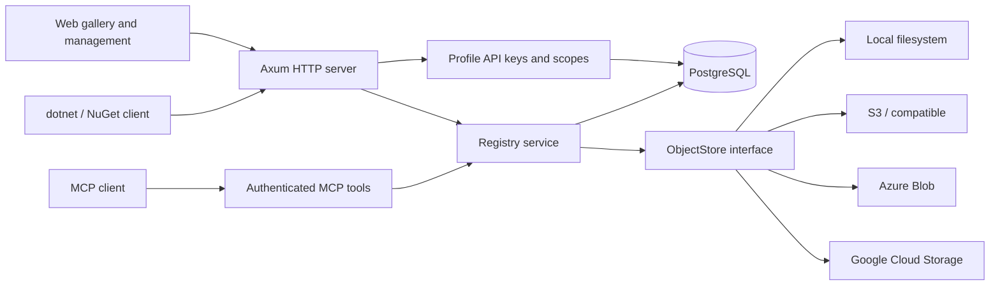

# Architecture

## Modules

| Module | Responsibility |
| --- | --- |
| `config` | Validate environment, external origin and upload limits |
| `auth` | Profile access, hashed credentials, restricted child keys |
| `version` | NuGet version normalization, 4-part support and sortable precedence keys |
| `package` | Bounded ZIP/nuspec parsing, identity, dependency groups |
| `registry` | NuGet V3 documents, publication, streaming downloads and search |
| `storage` | Provider selection behind `Arc<dyn ObjectStore>` |
| `mcp` | Read-only stateless HTTP MCP protocol |
| `upstream` | Source routing, credential references, network validation, metadata/archival cache, private read grants and management |
| `feeds` | Named-feed authorization, schema pools, shared identities and scoped object-store prefixes |
| `audit` | NuGet vulnerability snapshots, fixed-source synchronization and affected-version lookup |
| `maintenance` | Cache quota/idle eviction, protected versions, delayed deletion and bounded orphan scans |
| `events` | Audit attempts, sanitized results, durable webhook outbox and signed delivery retries |
| `symbols` | `.snupkg` validation, portable-PDB identification, per-PDB storage and the symbol server endpoint |
| `assets` / `deprecation` | Safe Markdown and package assets, ownership-protected lifecycle metadata |
| `trusted` | GitHub JWKS/signature and claim verification, token replay prevention and temporary feed-bound credentials |
| `routes` | Route tables grouped by audience (web, NuGet V3, push, packages, identity, operations, integrations, feed dispatch) |
| `guard` | Per-client limiter for rejected credentials and the cached storage write probe |
| `backup` | Provider-independent export, verification and import of package storage with a SHA-256 manifest |
| `lib` / `main` | Router assembly and layers (timeouts, security headers, concurrency bound), startup/migrations/shutdown and the `storage-*` commands |
| `web` | Buildless gallery and management UI embedded into the binary |

## Publication and ownership

1. Authenticate profile API key and require `package:push`.
2. Bound request size/concurrency; parse package metadata on a blocking worker.
3. Enforce the key's package prefix.
4. Begin database transaction; acquire an advisory lock on the normalized package ID.
5. Check profile ownership and immutable `(package_id, normalized_version)` uniqueness.
6. Write package under a fresh storage key; store nuspec inline in PostgreSQL.
7. Insert metadata and refresh search documents in the same transaction; commit.

Readers only observe committed metadata. PostgreSQL constraints and locks cover multiple server replicas. The object store and PostgreSQL do not share a distributed transaction. If the process dies after a blob is written but before commit, the blob can remain orphaned. Backups need both PostgreSQL and storage; restoration must preserve storage keys. Unlist/relist preserves blob content and downloadable versions.

Normalized URL identity is lowercase and drops build metadata. Display metadata keeps normalized full versions. Precedence supports four numeric components and case-insensitive NuGet prerelease identifiers. Numeric prerelease identifiers sort numerically; releases sort after prereleases for the same numeric version. Search has separate channels to exclude SemVer2 packages for clients that do not advertise `semVerLevel=2.0.0`.

## Symbols

`SymbolPackagePublish/4.9.0` in the service index points NuGet clients at `PUT /api/v2/symbolpackage`. A symbol push takes the same advisory lock as package push, requires an existing version owned by the caller and rejects a second symbol package for that version. Each portable PDB is stored as its own object (`{id}/{version}/{uuid}.pdb`) and indexed by file name and the key debuggers derive from the PDB ID, so `GET /symbols/{file}/{key}/{file}` is one indexed lookup plus one object read. The orphan scan treats `.pdb` objects like `.nupkg` objects and consults `symbol_files` before deleting. Details: [symbols guide](symbols.md).

## Search

Named feeds reuse registry operations against isolated PostgreSQL schemas and object-store prefixes. Shared identities, feed memberships, audit snapshots, events and Trusted Publishing policies live in `public`. Feed-specific package/cache migrations run separately from root migrations. Prefix-limited named-feed reads filter search and protect direct package/assets/MCP lookup paths. New private-feed requests re-check current membership rather than caching authorization.

The table has at most four records per package ID instead of one record per historical version. Latest records are updated transactionally on publish and visibility changes. GIN indexes serve weighted `tsvector` and `pg_trgm` matching; B-tree prefix/recent indexes serve appropriate queries. Inputs use prepared bind parameters, literal wildcard escaping, deterministic tie-breaking and bounded pagination. Search count and page use one repeatable-read snapshot. Per-result version lists are fetched by package ID using indexed lookups.

The `simple` dictionary preserves technical identifiers rather than language stemming. Dot-separated identifiers are additionally served by prefix and fuzzy ID matching. For larger deployments, monitor `EXPLAIN (ANALYZE, BUFFERS)` on representative queries, vacuum/analyze, common-query count costs and connection pool pressure. Generic queries can legitimately require scans or sorts; no latency SLA is implied by the presence of indexes.

## Credentials and management

Admin bootstrap credential comes from deployment configuration. Profile keys are server-generated random tokens with SHA-256 lookup hashes, labels, scopes, prefix and optional expiration. Admin comparison uses constant-time digest comparison. Database lookup rejects revoked/expired keys on each request. The browser keeps its login key only in memory. Management endpoints are uncached. The admin key cannot publish; a publisher key is required for ownership attribution.

A `keys:manage` key can issue restricted child keys for its own profile. A child cannot gain scopes, broaden a prefix or outlive its issuer. Revoking an issuer does not cascade to previously issued children: each key is an independent credential. A key with management permission can revoke any key in the same profile; grant this scope only when credential administration is intended.

Storage credentials are deployment secrets and are never returned by the UI API. They are separate from profile keys. The configuration page displays provider/origin information but does not mutate environment secrets.

## MCP

One `/mcp` endpoint accepts JSON-RPC POST requests. Initialization advertises tools only; tool calls share the registry service and PostgreSQL index with NuGet search. No MCP mutation tools are exposed. The server requires `mcp:read`, validates browser Origin, negotiates protocol `2025-06-18`, emits JSON responses and accepts notifications with 202. It keeps no session state and offers no standalone SSE stream. Private upstream reads additionally require `package:read`, a profile grant, and a matching key prefix; public reads remain available to MCP keys.

## Upstream proxy and cache

Local package namespaces take precedence and never fall back for missing versions. Upstream package IDs are pinned to one registry after the first successful resolution. Source matching uses exact IDs, longest prefixes, then a catch-all; only candidates with equal highest specificity participate in priority fallback. Only package-ID 404s advance to the next source.

Upstream metadata, downloaded archives, negative entries and search documents live in separate tables; no synthetic publisher profile is created. Catalog URLs are rewritten to NuShelf. PostgreSQL locks deduplicate metadata and archive requests across replicas. Source-level locks coordinate fetches with configuration/cleanup. Downloaded metadata joins indexed search; private rows are filtered by source grants and key scope/prefix, while public statistics exclude them.

Upstream secrets are environment references. Authentication remains on the configured origin during redirects and resource discovery. HTTPS, DNS/IP validation, size/deadline limits and optional checksum verification apply before storing archives. Authenticated sources default to private, with explicit profile grants and `package:read` required; MCP additionally requires `mcp:read`.

Details and operational boundaries: [upstream guide](upstreams.md).

## Deployment

Runtime container is a stripped Rust binary on Debian slim, runs as UID 10001 and embeds gallery assets. Bind inside Docker is `0.0.0.0:5000`; host publication defaults to localhost. PostgreSQL is private to the Compose network. `PUBLIC_URL` must be a reachable origin and is independent of the internal bind address. Reverse proxy deployments must set it to the external HTTPS origin. The app handles termination gracefully and closes its connection pool.

Readiness checks PostgreSQL, lists an unused prefix in the package store and writes then deletes a probe object (success cached for 30 seconds), so a missing bucket, rejected credentials or a read-only store take the replica out of service. A configurable number of simultaneous uploads (default four) and a per-package size bound limit memory pressure.

Requests are bounded by a response timeout (a longer one for uploads, which includes reading the body) and by an idle timeout on request and response bodies. A limiter on rejected credentials runs once at the edge; named-feed requests re-dispatched into the feed-scoped router skip it so failures are not counted twice. Package storage backups are consistent without stopping the server because archives are immutable; database dump first, storage second. Remote storage operation failures are logged server-side without exposing their internal messages to clients. Download counters count served GET requests, including retries, rather than unique users; HEAD and nuspec reads are excluded.
