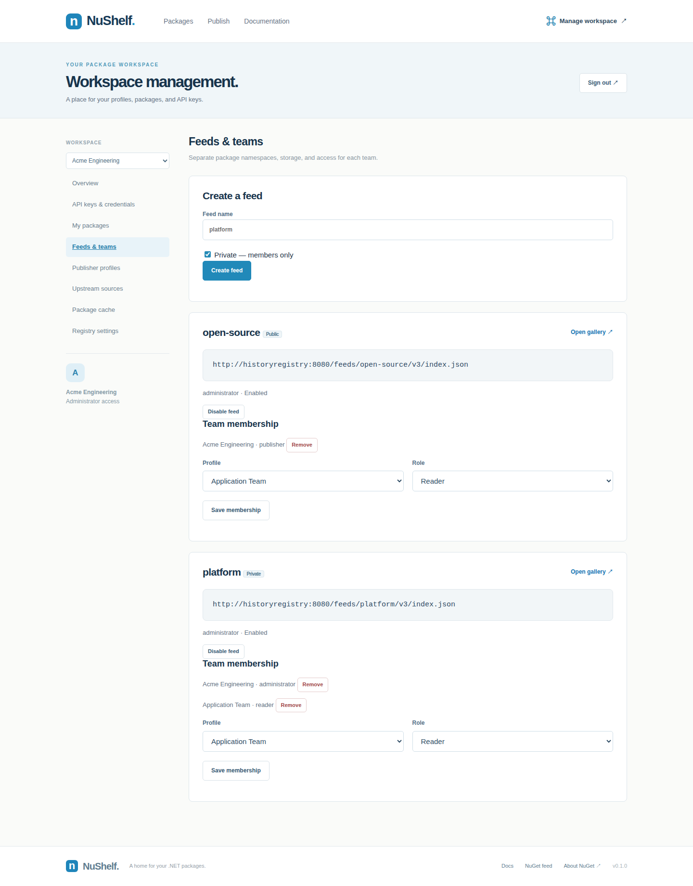

# Named feeds and team access

Create feeds in **Manage → Feeds & teams**. New feeds are private by default. Add existing publisher profiles as readers, publishers, or administrators.

Each feed has its own package IDs, versions, search index, upstream configuration and object-store prefix. The same package ID/version can be independently published in different feeds. Profiles and API keys are shared; both membership and key scopes must allow an operation.

| Role | Access |
| --- | --- |
| Reader | Read a private feed with `package:read` |
| Publisher | Read and publish; key scopes and package ownership still apply |
| Administrator | Publisher access plus feed settings/membership with `feeds:manage` |

Workspace administrators manage upstream configuration and credentials. Feed administrators cannot create global publisher profiles or escalate API key scopes. Removing membership takes effect on the next request. Disable a feed to stop all scoped access without deleting packages.

Use `/feeds/<name>/v3/index.json` as the NuGet source and `/feeds/<name>/mcp` for MCP. Private NuGet clients authenticate with HTTP Basic (any username, profile API key as password), or a Bearer key. Publishing additionally needs `package:push`; MCP additionally needs `mcp:read`. Prefix-limited read keys filter search/autocomplete and cannot access other package IDs. Aggregate statistics require an unrestricted key.

The existing root registry remains public. Named public feeds allow anonymous reads; publishing needs membership and a scoped key. The private gallery shell is public so users can open management and sign in; package API data requires authorization. Browser credentials remain in memory.

## Operations

Named feeds use PostgreSQL schemas `feed_<UUID>` and storage prefixes `feeds/<UUID>/`. Shared identity tables stay in `public`. Root and named-feed migrations are maintained separately. Existing feeds migrate on startup; new feeds migrate before first use. Each feed pool has up to four connections; idle connections expire after 60 seconds. The management limit is 100 feeds; size PostgreSQL capacity for active feeds. Backup the entire database and configured object store together.
